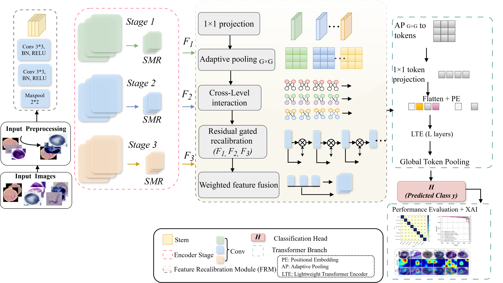

<h2 align="center">MCR-TokenNet: Compact Morphology Recalibration and Token Reasoning for Robust Microscopy Classification</h2>

<p align="center">PyTorch implementation for microscopy image classification.</p>

## Overview 🔍

<p align="center">
  
</p>

**Figure 1.** Overview of the MCR-TokenNet framework.

**Abstract.** MCR-TokenNet combines stage-wise morphology refinement (SMR), feature recalibration (FRM), and compact Transformer-based token reasoning to classify microscopy images. SMR refines local morphological features, FRM integrates representations across feature levels, and a 7 × 7 token grid models contextual relationships. Experiments on NIH Malaria, BBBC041, and Multi-Parasite benchmarks evaluate recognition performance, robustness, and cross-magnification transfer.

## Datasets 📚

| Dataset | Images / crops | Classes | Partitioning |
| --- | ---: | ---: | --- |
| [NIH Malaria](https://ceb.nlm.nih.gov/repositories/malaria-datasets/) | 27,558 | 2 | Patient-aware |
| [BBBC041](https://bbbc.broadinstitute.org/BBBC041) | 79,672 | 6 | Source-image-aware |
| [Multi-Parasite](https://data.mendeley.com/datasets/38jtn4nzs6/3) | 34,298 | 8 | Class-stratified |

The train/validation/test manifests are available under [`splits/`](splits/): [`nih_malaria.csv`](splits/nih_malaria.csv), [`bbbc041.csv`](splits/bbbc041.csv), and [`multi_parasite.csv`](splits/multi_parasite.csv). Download the images from the original dataset providers and arrange prepared image paths to match the manifests.

## Getting Started 🚀

### 1. Install Environment

The experiments used Python 3.12.8, PyTorch 2.5.1, and CUDA 12.4. Install a compatible PyTorch build, then install the project:

```bash
pip install -e .
```

### 2. Prepare Datasets

Place the prepared images in a local dataset directory. For example, using NIH Malaria, calculate normalization statistics from the training partition:

```bash
python scripts/normalization.py --manifest splits/nih_malaria.csv --image-root data/nih_malaria --output data/nih_normalization.json
```

### 3. Train MCR-TokenNet

```bash
python scripts/train.py --dataset "NIH Malaria" --manifest splits/nih_malaria.csv --image-root data/nih_malaria --normalization data/nih_normalization.json --seed 42 --output runs/nih/seed_42
```

Model and training settings are in [`configs/`](configs/). The experimental seeds are **42, 123, and 3407**.

### 4. Test MCR-TokenNet

```bash
python scripts/evaluate.py --checkpoint runs/nih/seed_42/best.pt --manifest splits/nih_malaria.csv --image-root data/nih_malaria --output runs/nih/seed_42/evaluation
```

The repository also includes preprocessing, duplicate-screening, baseline configuration, and controlled-degradation evaluation utilities.

## Citation

If you use this implementation, please cite **“MCR-TokenNet: Compact Morphology Recalibration and Token Reasoning for Robust Microscopy Classification.”** See [`CITATION.cff`](CITATION.cff).

## License 📜

This project is licensed under the [MIT License](LICENSE).
