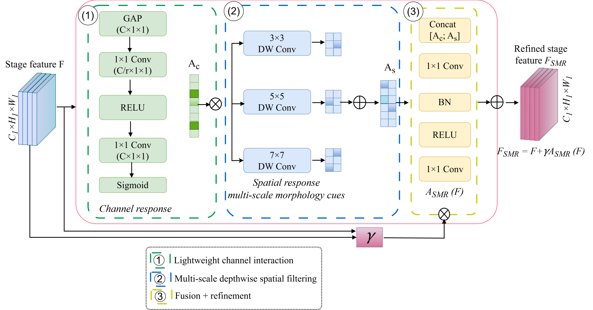
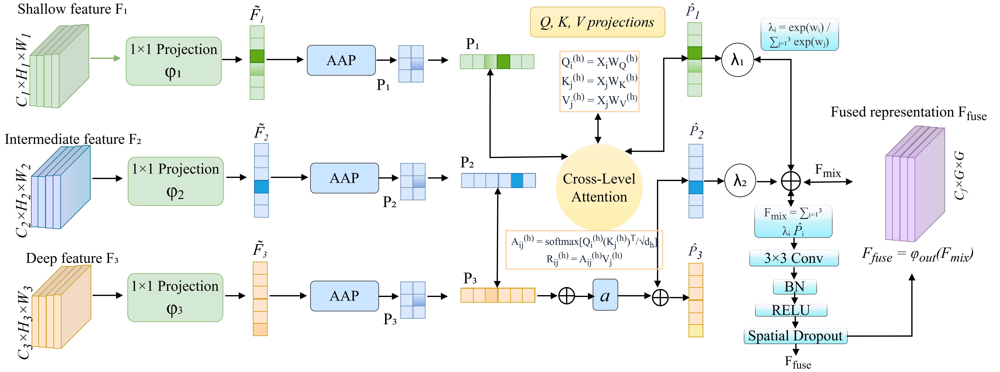

<h1 align="center">MCR-TokenNet</h1>

<p align="center"><strong>Compact Morphology Recalibration and Token Reasoning for Robust Microscopy Classification</strong></p>

<p align="center">PyTorch implementation for microscopy image classification.</p>

## Overview

MCR-TokenNet combines **Stage-wise Morphology Refinement (SMR)**, a **Feature Recalibration Module (FRM)** for cross-level interaction, and **compact token reasoning** with 49 visual tokens. The network is evaluated on binary malaria-cell classification, blood-cell and parasite-stage recognition, and multi-parasite microscopy.

<p align="center">
  
</p>
<p align="center"><em>Figure 2. MCR-TokenNet architecture.</em></p>

<details>
<summary><strong>Architecture modules: SMR and FRM</strong></summary>

<p align="center">
  
</p>
<p align="center"><em>Figure 3. Stage-wise Morphology Refinement (SMR).</em></p>

<p align="center">
  
</p>
<p align="center"><em>Figure 4. Feature Recalibration Module (FRM).</em></p>
</details>

## Datasets

| Dataset | Samples | Classes | Partitioning |
| --- | ---: | ---: | --- |
| [NIH Malaria](https://ceb.nlm.nih.gov/repositories/malaria-datasets/) | 27,558 cells | 2 | Patient-aware |
| [BBBC041](https://bbbc.broadinstitute.org/BBBC041) | 79,672 eligible crops | 6 | Source-image-aware |
| [Multi-Parasite](https://data.mendeley.com/datasets/38jtn4nzs6/3) | 34,298 images | 8 | Class-stratified image-level |

Download the datasets from their original providers. Each experiment reads a CSV manifest specifying the image path, class label, partition, and available group or magnification metadata. The accepted fields are `sample_id`, `relative_path`, `class_label`, `split`, `group_id`, and `magnification` (where applicable).

## Getting Started

### Installation

Recommended environment: Python 3.12, PyTorch 2.5.1, CUDA 12.4. Install a compatible PyTorch build for your platform, then install the package:

```bash
pip install -e .
```

For pretrained baseline models and automated tests:

```bash
pip install -e '.[baselines,test]'
python -m pytest -q
```

### Data preparation

Validate patient-aware NIH Malaria partitions:

```bash
python scripts/prepare_data.py --inventory splits/nih_malaria.csv \
  --partition-unit patient --output splits/nih_malaria_checked.csv
```

For a new seeded partition, append `--generate-new --seed 42`. For BBBC041, use `--partition-unit source_image`; for Multi-Parasite, use `--partition-unit image`.

Generate BBBC041 cell crops from bounding-box annotations:

```bash
python scripts/crop_bbbc041.py --annotations annotations.jsonl \
  --image-root data/bbbc041/fields --out-dir data/bbbc041/crops
```

The annotation JSONL contains `annotation_id`, `source_image`, `source_image_id`, `class_label`, `difficult`, and bounding-box coordinates `x`, `y`, `w`, `h` (pixels).

Estimate normalization using the training partition, then screen for cross-partition duplicates:

```bash
python scripts/normalization.py --manifest splits/nih_malaria_checked.csv \
  --image-root data/nih_malaria --output splits/nih_normalization.json

python scripts/manifest_hashes.py --inventory splits/multi_parasite.csv \
  --image-root data/multi_parasite --dataset 'Multi-Parasite' \
  --out splits/multi_parasite_hashed.csv

python scripts/check_duplicates.py --manifest splits/multi_parasite_hashed.csv \
  --out runs/duplicate_screening
```

### Training

Model and optimizer settings are provided in `configs/model.yaml` and `configs/training.yaml`. The three configured training seeds are **42, 123, and 3407**.

```bash
python scripts/train.py --dataset 'NIH Malaria' \
  --manifest splits/nih_malaria_checked.csv --image-root data/nih_malaria \
  --normalization splits/nih_normalization.json \
  --seed 42 --output runs/nih/seed_42
```

Repeat for the remaining seeds using separate output directories. Select the representative checkpoint by validation macro-F1:

```bash
python scripts/select_run.py --runs runs/nih/seed_42 runs/nih/seed_123 \
  runs/nih/seed_3407 --output runs/nih/representative_run.json
```

For cross-magnification experiments, `scripts/train.py` supports `--source-magnification 400x` or `1000x` together with `--shared-classes Leukocyte Toxoplasma`.

### Evaluation and inference

```bash
python scripts/evaluate.py --checkpoint runs/nih/seed_42/best.pt \
  --manifest splits/nih_malaria_checked.csv --image-root data/nih_malaria \
  --output runs/nih/seed_42/evaluation

python scripts/predict.py --checkpoint runs/nih/seed_42/best.pt \
  --image data/nih_malaria/example.png
```

The evaluation interface supports `--magnification 400x` or `1000x` for directional transfer evaluation. Controlled-degradation evaluation is available through:

```bash
python scripts/robustness.py --checkpoint runs/nih/seed_42/best.pt \
  --manifest splits/nih_malaria_checked.csv --image-root data/nih_malaria \
  --output runs/nih/seed_42/robustness.json
```

Model complexity can be inspected with `python scripts/profile_model.py --classes 6`. Statistical comparisons are implemented in `scripts/statistics.py`.

## Model weights and data

Use dataset manifests in `splits/` and trained checkpoints in `checkpoints/`, or provide paths directly to the command-line tools. Microscopy images are downloaded separately from the dataset providers.

## Citation

If you use MCR-TokenNet, cite **“MCR-TokenNet: Compact Morphology Recalibration and Token Reasoning for Robust Microscopy Classification.”** Citation metadata are provided in [`CITATION.cff`](CITATION.cff).
